<!-- Artwork and the featured project table are generated by python -m gen. -->

# Manoj Kumar Bondada

<picture>
  <source media="(prefers-color-scheme: dark)" srcset="assets/dark/boot.svg">
  
</picture>

I’m a B.Tech Computer Science student. I build full-stack applications for ordering and scheduling, and I’m exploring AI and machine learning.

[Portfolio](https://frontend-steel-nine-30.vercel.app/) · [LinkedIn](https://www.linkedin.com/in/manoj-kumar-bondada-a92410384) · [Email](mailto:manojkumarbondada123@gmail.com)

## Featured projects

<!-- STAGES:START -->

| Project | What it does | Stack | Links |
| --- | --- | --- | --- |
| **Portfolio** | 3D robotic arm and interactive project showcase. | React · Three.js | [Source](https://github.com/ManojKumar0013/portfolio1) · [Live demo](https://frontend-steel-nine-30.vercel.app/) |
| **ICEPOPS** | Online ordering, loyalty rewards, and live order tracking. | React · FastAPI | [Source](https://github.com/ManojKumar0013/icepop) · [Live demo](https://icepop-gray.vercel.app/) |
| **HungryHub** | Multi-role food ordering app with a relational database. | React · Express · PostgreSQL | [Source](https://github.com/ManojKumar0013/HungryHub-Online-Food-Ordering-System-) · [Live demo](https://hungry-hub-online-food-ordering-sys.vercel.app/) |
| **NexTune** | Mood-based music discovery and playlists. | Vue · Jamendo API | [Source](https://github.com/ManojKumar0013/EMOTION_BASED_MUSIC_WEBSITE) · [Live demo](https://manojkumar0013.github.io/EMOTION_BASED_MUSIC_WEBSITE/) |
| **Clinic Appointment Scheduler** | Team project for doctor schedules and patient bookings. | Java | [Source](https://github.com/ManojKumar0013/23CSE111_CLINIC_APPOINTEMENT_SYSTEM_C4) |

<!-- STAGES:END -->

## Technologies

| Area | Stack |
| --- | --- |
| Frontend | JavaScript, TypeScript, React, Vue, Three.js |
| Backend and data | Python, FastAPI, Node.js, Express, PostgreSQL |
| Coursework | C, Java, Kotlin |

Arcade project and language cards

<picture>
  <source media="(prefers-color-scheme: dark)" srcset="assets/dark/stages.svg">
  
</picture>

<picture>
  <source media="(prefers-color-scheme: dark)" srcset="assets/dark/skills.svg">
  
</picture>

## GitHub activity

<!-- ACTIVITY:START -->

**63 contributions in 2026** · **2-day current streak** · **4-day best streak this year**

Snapshot from GitHub on 2026-11-14 (UTC).

<!-- ACTIVITY:END -->

<picture>
  <source media="(prefers-color-scheme: dark)" srcset="assets/dark/level.svg">
  
</picture>

Arcade scoreboard

<picture>
  <source media="(prefers-color-scheme: dark)" srcset="assets/dark/scores.svg">
  
</picture>

How this profile is built

The artwork is generated by Python 3.10+ and stored in this repository in light and dark versions. GitHub Actions refreshes the profile daily and on demand. When a refresh fails, the previous snapshot stays visible. The contribution map uses GitHub’s calendar for the current year. Language cards count public, non-fork repositories owned by this account, excluding this profile repository.

Edit `gen/config.json` to curate projects and run `python -m gen` from the repository root to refresh the profile locally. Run `python -m gen --check` to validate the published files offline.

[View profile refresh runs](https://github.com/ManojKumar0013/ManojKumar0013/actions/workflows/render.yml)

