<!--
  MANOJ//OS — Arcade Edition.
  Every panel is an animated SVG drawn by `python -m gen` (see gen/) and redrawn daily
  by .github/workflows/render.yml from live GitHub data. No outside services.
-->

<picture>
  <source media="(prefers-color-scheme: dark)" srcset="assets/dark/boot.svg">
  
</picture>

<picture>
  <source media="(prefers-color-scheme: dark)" srcset="assets/dark/skills.svg">
  
</picture>

<picture>
  <source media="(prefers-color-scheme: dark)" srcset="assets/dark/scores.svg">
  
</picture>

<picture>
  <source media="(prefers-color-scheme: dark)" srcset="assets/dark/level.svg">
  
</picture>

<picture>
  <source media="(prefers-color-scheme: dark)" srcset="assets/dark/stages.svg">
  
</picture>

<!-- STAGES:START -->

  <a href="https://github.com/ManojKumar0013/icepop"><code>01 icepop</code></a> ·
  <a href="https://github.com/ManojKumar0013/HungryHub-Online-Food-Ordering-System-"><code>02 HungryHub-Online-Food-Ordering-System-</code></a> ·
  <a href="https://github.com/ManojKumar0013/EMOTION_BASED_MUSIC_WEBSITE"><code>03 EMOTION_BASED_MUSIC_WEBSITE</code></a> ·
  <a href="https://github.com/ManojKumar0013/23CSE111_CLINIC_APPOINTEMENT_SYSTEM_C4"><code>04 23CSE111_CLINIC_APPOINTEMENT_SYSTEM_C4</code></a> ·
  <a href="https://github.com/ManojKumar0013/Circle-Accuracy-Challenge"><code>05 Circle-Accuracy-Challenge</code></a> ·
  <a href="https://github.com/ManojKumar0013/neetcode-submissions"><code>06 neetcode-submissions</code></a>

<!-- STAGES:END -->

<picture>
  <source media="(prefers-color-scheme: dark)" srcset="assets/dark/contact.svg">
  
</picture>

  <a href="https://www.linkedin.com/in/manoj-kumar-bondada-a92410384"><code>▶ linkedin → /in/manoj-kumar-bondada</code></a> ·
  <a href="mailto:manojkumarbondada123@gmail.com"><code>▶ mail → manojkumarbondada123@gmail.com</code></a>

<code>$ cat HOW_IT_WORKS.txt</code>

- `gen/stats.py` pulls live data from GitHub (GraphQL in Actions, the public API locally).
- `gen/panels/*.py` draw each screen as a plain SVG with CSS animation, which GitHub plays inside images. Each one has a dark and a light version.
- Skill levels come from how much of each language is in the repos (`gen/config.json` maps React to TypeScript). Skills with no code yet show **IN TRAINING**.
- Stages pick the starred repos first, then the most recently pushed ones. Forks and this repo are skipped.
- `.github/workflows/render.yml` redraws everything daily at 03:17 UTC. If GitHub can't be reached, the last good panels stay up.
- Run it yourself: `python -m gen` (Python 3.10+, no packages needed).

