<!-- PROFILE:START -->

# Manoj Kumar Bondada

<a href="https://manojkumar0013.github.io/ManojKumar0013/game/">
<picture>
  <source media="(max-width: 600px) and (prefers-color-scheme: dark)" srcset="assets/dark/boot-mobile.svg">
  <source media="(max-width: 600px)" srcset="assets/light/boot-mobile.svg">
  <source media="(prefers-color-scheme: dark)" srcset="assets/dark/boot.svg">
  
</picture>
</a>

**[▶ PLAY THE GAME](https://manojkumar0013.github.io/ManojKumar0013/game/)**

I’m a B.Tech Computer Science student working toward AI/ML engineering roles. I build full-stack systems and am learning to design reproducible ML experiments, compare baselines, and explain what the metrics mean.

[Linkedin](https://www.linkedin.com/in/manoj-kumar-bondada-a92410384) · [Email](mailto:manojkumarbondada123@gmail.com) · [Portfolio](https://frontend-steel-nine-30.vercel.app/)

<picture>
  <source media="(max-width: 600px) and (prefers-color-scheme: dark)" srcset="assets/dark/training-mobile.svg">
  <source media="(max-width: 600px)" srcset="assets/light/training-mobile.svg">
  <source media="(prefers-color-scheme: dark)" srcset="assets/dark/training.svg">
  
</picture>

<picture>
  <source media="(max-width: 600px) and (prefers-color-scheme: dark)" srcset="assets/dark/skills-mobile.svg">
  <source media="(max-width: 600px)" srcset="assets/light/skills-mobile.svg">
  <source media="(prefers-color-scheme: dark)" srcset="assets/dark/skills.svg">
  
</picture>

<picture>
  <source media="(max-width: 600px) and (prefers-color-scheme: dark)" srcset="assets/dark/achievements-mobile.svg">
  <source media="(max-width: 600px)" srcset="assets/light/achievements-mobile.svg">
  <source media="(prefers-color-scheme: dark)" srcset="assets/dark/achievements.svg">
  
</picture>

[Latest public commit](https://github.com/ManojKumar0013/portfolio1/commit/2bd21cce223646ff038de24c015d7720c0115bcc) · [Earliest public PR found](https://github.com/kitlord/First-issue/pull/61)

<picture>
  <source media="(max-width: 600px) and (prefers-color-scheme: dark)" srcset="assets/dark/stages-mobile.svg">
  <source media="(max-width: 600px)" srcset="assets/light/stages-mobile.svg">
  <source media="(prefers-color-scheme: dark)" srcset="assets/dark/stages.svg">
  
</picture>

| Project | What it does |
| --- | --- |
| [Portfolio](https://github.com/ManojKumar0013/portfolio1) | Interactive project showcase with a 3D robotic arm. |
| [HungryHub](https://github.com/ManojKumar0013/HungryHub-Online-Food-Ordering-System-) | Multi-role food ordering with a PostgreSQL data model. |
| [ICEPOPS](https://github.com/ManojKumar0013/icepop) | Online ordering, loyalty and live order tracking. |
| [NexTune](https://github.com/ManojKumar0013/EMOTION_BASED_MUSIC_WEBSITE) | Mood-based music discovery with the Jamendo API. |
| [Clinic Scheduler](https://github.com/ManojKumar0013/23CSE111_CLINIC_APPOINTEMENT_SYSTEM_C4) | Java team project for appointments and schedules. |
| [Time Tick Quiz](https://github.com/ManojKumar0013/Time-Tick-Quiz) | Python quiz project. |

<a href="https://manojkumar0013.github.io/ManojKumar0013/game/">
<picture>
  <source media="(max-width: 600px) and (prefers-color-scheme: dark)" srcset="assets/dark/level-mobile.svg">
  <source media="(max-width: 600px)" srcset="assets/light/level-mobile.svg">
  <source media="(prefers-color-scheme: dark)" srcset="assets/dark/level.svg">
  
</picture>
</a>

<picture>
  <source media="(max-width: 600px) and (prefers-color-scheme: dark)" srcset="assets/dark/scores-mobile.svg">
  <source media="(max-width: 600px)" srcset="assets/light/scores-mobile.svg">
  <source media="(prefers-color-scheme: dark)" srcset="assets/dark/scores.svg">
  
</picture>

<picture>
  <source media="(max-width: 600px) and (prefers-color-scheme: dark)" srcset="assets/dark/contact-mobile.svg">
  <source media="(max-width: 600px)" srcset="assets/light/contact-mobile.svg">
  <source media="(prefers-color-scheme: dark)" srcset="assets/dark/contact.svg">
  
</picture>

[Linkedin](https://www.linkedin.com/in/manoj-kumar-bondada-a92410384) · [Email](mailto:manojkumarbondada123@gmail.com) · [Portfolio](https://frontend-steel-nine-30.vercel.app/)

<!-- PROFILE:END -->

<code>$ cat HOW_IT_WORKS.txt</code>

- `gen/stats.py` pulls live data from GitHub (GraphQL in Actions, the public API locally).
- `gen/panels/*.py` draw each screen as a plain SVG with CSS animation, which GitHub plays inside images. Each one has a dark and a light version.
- Skill levels come from how much of each language is in the repos (`gen/config.json` maps React to TypeScript). Skills with no code yet show **IN TRAINING**.
- Stages pick the starred repos first, then the most recently pushed ones. Forks and this repo are skipped.
- `.github/workflows/render.yml` redraws everything daily at 03:17 UTC. If GitHub can't be reached, the last good panels stay up.
- Run it yourself: `python -m gen` (Python 3.10+, no packages needed).

