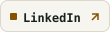
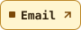

<!-- PROFILE:START -->

# Manoj Kumar Bondada

<a href="https://manojkumar0013.github.io/ManojKumar0013/game/">
<picture>
  <source media="(max-width: 600px) and (prefers-color-scheme: dark)" srcset="assets/dark/boot-mobile.svg">
  <source media="(max-width: 600px)" srcset="assets/light/boot-mobile.svg">
  <source media="(prefers-color-scheme: dark)" srcset="assets/dark/boot.svg">
  
</picture>
</a>

<a href="https://manojkumar0013.github.io/ManojKumar0013/game/"><picture><source media="(prefers-color-scheme: dark)" srcset="assets/dark/action-0.svg"></picture></a> &nbsp; <a href="https://www.linkedin.com/in/manoj-kumar-bondada-a92410384"><picture><source media="(prefers-color-scheme: dark)" srcset="assets/dark/action-1.svg"></picture></a> &nbsp; <a href="mailto:manojkumarbondada123@gmail.com"><picture><source media="(prefers-color-scheme: dark)" srcset="assets/dark/action-2.svg"></picture></a> &nbsp; <a href="https://frontend-steel-nine-30.vercel.app/"><picture><source media="(prefers-color-scheme: dark)" srcset="assets/dark/action-3.svg"></picture></a>

<picture>
  <source media="(max-width: 600px) and (prefers-color-scheme: dark)" srcset="assets/dark/skills-mobile.svg">
  <source media="(max-width: 600px)" srcset="assets/light/skills-mobile.svg">
  <source media="(prefers-color-scheme: dark)" srcset="assets/dark/skills.svg">
  
</picture>

<picture>
  <source media="(max-width: 600px) and (prefers-color-scheme: dark)" srcset="assets/dark/stages-mobile.svg">
  <source media="(max-width: 600px)" srcset="assets/light/stages-mobile.svg">
  <source media="(prefers-color-scheme: dark)" srcset="assets/dark/stages.svg">
  
</picture>

<a href="https://github.com/ManojKumar0013/portfolio"><picture><source media="(prefers-color-scheme: dark)" srcset="assets/dark/project-1.svg"></picture></a> &nbsp; <a href="https://github.com/ManojKumar0013/HungryHub-Online-Food-Ordering-System-"><picture><source media="(prefers-color-scheme: dark)" srcset="assets/dark/project-2.svg"></picture></a> &nbsp; <a href="https://github.com/ManojKumar0013/icepop"><picture><source media="(prefers-color-scheme: dark)" srcset="assets/dark/project-3.svg"></picture></a>

<a href="https://github.com/ManojKumar0013/EMOTION_BASED_MUSIC_WEBSITE"><picture><source media="(prefers-color-scheme: dark)" srcset="assets/dark/project-4.svg"></picture></a> &nbsp; <a href="https://github.com/ManojKumar0013/23CSE111_CLINIC_APPOINTEMENT_SYSTEM_C4"><picture><source media="(prefers-color-scheme: dark)" srcset="assets/dark/project-5.svg"></picture></a> &nbsp; <a href="https://github.com/ManojKumar0013/Time-Tick-Quiz"><picture><source media="(prefers-color-scheme: dark)" srcset="assets/dark/project-6.svg"></picture></a>

<a href="https://manojkumar0013.github.io/ManojKumar0013/game/">
<picture>
  <source media="(max-width: 600px) and (prefers-color-scheme: dark)" srcset="assets/dark/level-mobile.svg">
  <source media="(max-width: 600px)" srcset="assets/light/level-mobile.svg">
  <source media="(prefers-color-scheme: dark)" srcset="assets/dark/level.svg">
  
</picture>
</a>

<picture>
  <source media="(max-width: 600px) and (prefers-color-scheme: dark)" srcset="assets/dark/scores-mobile.svg">
  <source media="(max-width: 600px)" srcset="assets/light/scores-mobile.svg">
  <source media="(prefers-color-scheme: dark)" srcset="assets/dark/scores.svg">
  
</picture>

<picture>
  <source media="(max-width: 600px) and (prefers-color-scheme: dark)" srcset="assets/dark/contact-mobile.svg">
  <source media="(max-width: 600px)" srcset="assets/light/contact-mobile.svg">
  <source media="(prefers-color-scheme: dark)" srcset="assets/dark/contact.svg">
  
</picture>

<a href="https://www.linkedin.com/in/manoj-kumar-bondada-a92410384"><picture><source media="(prefers-color-scheme: dark)" srcset="assets/dark/action-1.svg"></picture></a> &nbsp; <a href="mailto:manojkumarbondada123@gmail.com"><picture><source media="(prefers-color-scheme: dark)" srcset="assets/dark/action-2.svg"></picture></a> &nbsp; <a href="https://frontend-steel-nine-30.vercel.app/"><picture><source media="(prefers-color-scheme: dark)" srcset="assets/dark/action-3.svg"></picture></a>

<!-- PROFILE:END -->
